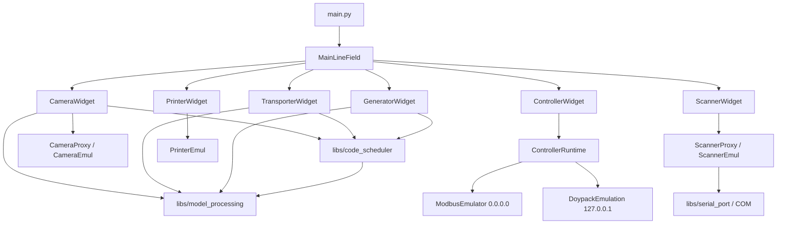
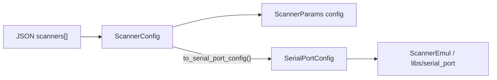
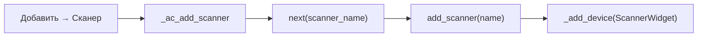
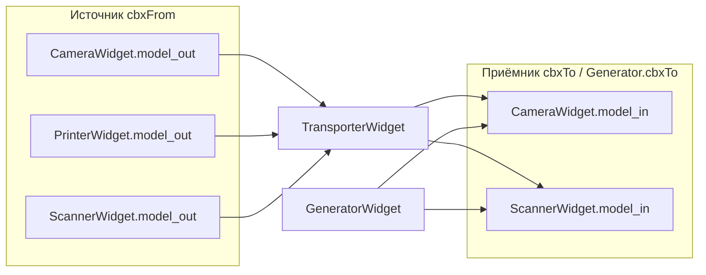

# Эмулятор производственной линии

| Параметр | Значение |
|----------|----------|
| Точка входа | `main.py` |
| Версия | `client_info.VERSION` (например `1.0.0.1.b0009`) |
| Главное окно | `core/main_ui/line_emul.py` → `MainLineField` |
| UI-форма | `forms/Main.py` → `Ui_MainWindow` |
| Конфигурация | JSON через `core/main_ui/data.py` → `ConfigFile` |
| Сборка onedir | `build_project.py` (Windows без флагов; Linux freeze-only: `--linux`) → `build/spec/main.spec` → `build/install/dmcLineEmulator/` |
| Сборка `.deb` | Linux native или Windows через default WSL: см. [debian_packaging.md](debian_packaging.md); `build_project.py --deb` / `build_deb.py` → на Linux `build/deb/` + копия в `build/install/dmcLineEmulator/`; на Windows итоговый файл в `build/install/dmcLineEmulator/*.deb` |

## Назначение

Desktop-приложение на PySide6 для визуальной эмуляции производственной линии маркировки: камеры сканирования, эмулятор ручного сканера ШК (COM), **карточки контроллера** (Modbus TCP-сервер `0.0.0.0` + клиент цикла Doypack на `127.0.0.1` того же порта), транспортёры, генераторы кодов и принтеры. Виджеты устройств размещаются на холсте (`FlowLayout`), связываются по ID и настраиваются из JSON-конфига. Контроллеры **не** участвуют в перевозчиках, генераторах и в меню «Очистить данные» — см. [controller.md](controller.md).

## Архитектура



| Модуль | Роль |
|--------|------|
| `core/scanning/camera_widget.py` | Очередь отправки (`model_in`), результаты (`model_out`); `CodeScheduler` + per-code batch (`spInterval`, `spSize`); `tbDelete` / `delete_requested` |
| `core/barcode_scanner/scanner_widget.py` | Очередь отправки (`model_in`), подтверждённые коды (`model_out`); `CodeScheduler` + COM через `ScannerProxy`; `tbRefreshPorts` — повторное `_refresh_com_ports`; `tbDelete` / `delete_requested` |
| `core/transporting/transporter_widget.py` | Перенос кодов между связанными виджетами (`cbxFrom` → `model_out` источника, `cbxTo` → `model_in` приёмника); источник — камера/принтер/сканер, приёмник — камера/сканер; `CodeScheduler` + per-code FIFO; `tbDelete` / `delete_requested` |
| `core/generator/generator_widget.py` | Генерация кодов в `model_in` камеры или сканера (`cbxTo`); `CodeScheduler` + `_last_generated_at` (~`spInterval` между генерациями), `create_code_item`; `tbDelete` / `delete_requested` |
| `core/printing/printer_widget.py` | Буфер принтера (TCP), `cbLanguage` (Legacy/TSPL2/EZPL/ZPL/SAVEMA), `PrinterConfig.language`; `tbDelete` / `delete_requested` |
| `core/controller/` | Ядро Modbus/Doypack (`ModbusEmulator`, `DoypackEmulation`, `ControllerRuntime`); виджет — `core/controller/controller_widget.py`; отдельный реестр `_controller_widgets` в `MainLineField` — см. [controller.md](controller.md) |
| `core/barcode_scanner/scanner_core.py` | Эмулятор сканера ШК: очередь кодов, запись в COM (фоновый поток) |
| `core/barcode_scanner/scanner_proxy.py` | Qt-мост: `Signal scanned`, опрос ядра 250 мс |
| `libs/serial_port.py` | pyserial: перечисление портов, `SerialPortConfig`, open/write с суффиксом `\r\n` |
| `libs/model_processing.py` | Модели очередей Qt, хелперы per-code timing |
| `libs/code_scheduler.py` | Периодический тик (~10 мс) для проверки готовности кодов |

## Очереди кодов и per-code timing

Коды в pipeline представлены элементами `QStandardItem` в `QStandardItemModel`. Для моделирования времени прохождения кода через узел линии каждый элемент несёт метку прибытия в `Qt.UserRole` (см. `ARRIVAL_TIME_ROLE`).

Инфраструктура меток и проверки готовности реализована в `libs/model_processing.py` и описана в [model_processing_timing.md](model_processing_timing.md). Все точки входа кодов в pipeline (drop, загрузка модели, генератор, камера, транспортёр) создают элементы через `create_code_item` — см. раздел «Точки входа» в той же документации.

Периодический опрос готовности выполняет `CodeScheduler` (`libs/code_scheduler.py`): внутренний тик **10 мс** (`SCHEDULER_TICK_MS`, `Qt.TimerType.PreciseTimer`), callback виджета на каждом тике проверяет очередь через хелперы `model_processing`. Подробности — в [code_scheduler.md](code_scheduler.md).

Поле `spInterval` в UI виджетов (и поле `interval` в JSON-конфиге) задаёт требуемое время ожидания **для каждого конкретного кода** в очереди узла, а не период тика планировщика.

## Конфигурация JSON (`ConfigFile`)

Корневая Pydantic-модель — `core/main_ui/data.py` → `ConfigFile` (`strict=True`). Загрузка и сохранение выполняются в `MainLineField` (`open_config`, `save_configuration_to_file`) через `model_validate_json()` / `model_dump_json(indent=4)`.

| Поле | Тип | По умолчанию | Назначение |
|------|-----|--------------|------------|
| `printers` | `list[PrinterConfig]` | `[]` | принтеры (TCP) |
| `cameras` | `list[CameraConfig]` | `[]` | камеры сканирования (TCP) |
| `scanners` | `list[ScannerConfig]` | `[]` | эмуляторы ручного сканера ШК (COM) |
| `controllers` | `list[ControllerConfig]` | `[]` | Modbus TCP-контроллеры (Doypack); см. [config_controllers.md](config_controllers.md) |
| `transporters` | `list[TransporterConfig]` | `[]` | перевозчики между виджетами |
| `generators` | `list[GeneratorConfig]` | `[]` | генераторы кодов |

**Обратная совместимость:** поля со значением по умолчанию `[]` (в том числе `scanners` и `controllers`) могут отсутствовать в старых JSON-файлах — при десериализации подставляется пустой список, ошибки валидации не возникает.

#### Пример одной карточки контроллера в JSON

```json
{
    "controllers": [
        {
            "name": "CTL_5020",
            "port": 5020,
            "queue_size": 10,
            "mode": "simplex",
            "controller_type": "delta",
            "register_addresses": [4146, 4148, 4150]
        }
    ]
}
```

Подробности полей (в т.ч. **`register_addresses`**: `list[int]` **0…10000**, по умолчанию **`[]`**, обратная совместимость при отсутствии ключа) — [config_controllers.md](config_controllers.md).

### Модель конфигурации сканера (`ScannerConfig`)

Модуль: `core/barcode_scanner/data.py`. План: serial barcode scanner, подзадача **#2** (модель конфигурации).

| Класс | Роль |
|-------|------|
| `ScannerParams` | Параметры линии COM и суффикс штрихкода |
| `ScannerConfig` | Сохраняемое состояние одного виджета сканера |
| `ScannerConfig.to_serial_port_config()` | Преобразование в `libs/serial_port.SerialPortConfig` для `ScannerEmul` |



#### `ScannerParams`

Вложенный объект `config` внутри элемента `scanners[]`. Значения по умолчанию совпадают с `SerialPortConfig` в `libs/serial_port.py`.

| Поле | Тип | По умолчанию | Описание |
|------|-----|--------------|----------|
| `baud_rate` | `int` | `9600` | Скорость порта |
| `bytesize` | `int` | `8` | Размер символа (5–8) |
| `parity` | `str` | `"N"` | Чётность: `N`, `E`, `O`, `M`, `S` |
| `stopbits` | `float` | `1` | Стоп-биты: `1`, `1.5`, `2` |
| `suffix` | `str` | `"\r\n"` | Суффикс после кода при записи в COM |

#### `ScannerConfig`

| Поле | Тип | Обязательное | Описание |
|------|-----|--------------|----------|
| `name` | `str` | да | Имя виджета на холсте |
| `port_name` | `str` | да | Имя COM-порта ОС (например, `COM3`) |
| `config` | `ScannerParams` | да | Параметры линии и суффикс |

Метод `to_serial_port_config()` собирает `SerialPortConfig`: переносит `port_name` с верхнего уровня и поля `baud_rate`, `bytesize`, `parity`, `stopbits`, `suffix` из вложенного `config`. Используется при старте эмулятора, чтобы UI-слой не зависел напрямую от dataclass `libs/serial_port`.

#### Пример фрагмента JSON

```json
{
    "scanners": [
        {
            "name": "SCN_COM3",
            "port_name": "COM3",
            "config": {
                "baud_rate": 9600,
                "bytesize": 8,
                "parity": "N",
                "stopbits": 1,
                "suffix": "\r\n"
            }
        }
    ]
}
```

Файлы без секции `scanners` (например, `configs/test.json`) по-прежнему загружаются; список сканеров остаётся пустым.

#### Пример конфигурации `configs/scanner_example.json`

Готовый JSON для отладки цепочки **генератор → сканер (COM) → перевозчик → камера** (подзадача **#9**). Файл можно открыть через меню конфигурации в `MainLineField.open_config`.

| Секция | Содержание | Связь на холсте |
|--------|------------|-----------------|
| `scanners[]` | `SCAN_1`, `port_name`: `COM5`, 9600 8N1, суффикс `\r\n` | Эмулятор ручного сканера; порт — одна сторона пары com0com (см. [com0com_setup.md](com0com_setup.md)) |
| `generators[]` | `give_to`: `SCAN_1`, `interval`: 500 мс | Коды попадают в `ScannerWidget.model_in` |
| `transporters[]` | `take_from`: `SCAN_1`, `give_to`: `CAM_23`, `interval`: 250 мс | После записи в COM коды снимаются с `model_out` сканера и передаются в камеру |
| `cameras[]` | `CAM_23`, TCP-порт `23` | Приёмник перевозчика |

Перед запуском замените `port_name` на фактический COM из пары com0com или физического адаптера. Секции `printers` в примере нет — для минимального сценария сканера достаточно перечисленных полей.

Для отладки COM без физического адаптера см. [com0com_setup.md](com0com_setup.md).

Восстановление виджетов при `open_config`, запись в `save_configuration_to_file` и пункт меню «Добавить → Сканер» реализованы в `MainLineField` — см. раздел **«Интеграция сканера в главное окно»** ниже (подзадача **#5**).

## Интеграция контроллера в главное окно

| Элемент | Значение |
|---------|----------|
| Меню | «Добавить → Контроллер» (`acAddController`) |
| Реестр | `_controller_widgets` (отдельно от `_device_widgets`) |
| Генератор порта | `controller_port_generator`: **5020**, шаг **1**, верхняя граница как у принтера (`< 21100`); имя по умолчанию `CTL_<port>` |
| Холст | `add_controller` → `FlowLayout` (`scaDevices`), рядом с камерой/принтером/сканером |
| Сохранение | `save_configuration_to_file` — `controllers=[w.options() for w in _controller_widgets.values()]` |
| Загрузка | `process_config`: после сканеров — `_load_controllers` → `add_controller` + `load_options`; имена контроллеров **не** попадают в `devices` для перевозчиков/генераторов |
| Массовое управление | «Запустить/Остановить → Контроллеры»; «Всё»: устройства → **контроллеры** → перевозчики → генераторы; стоп — обратный порядок; **нет** в «Очистить данные» |
| Удаление | `delete_requested` → `_remove_controller`; `clear_ui` / `closeEvent` — `run(False)` для контроллеров |

Подробности адресов, stop через `ModbusTcpServer.shutdown()` и исключение из combo перевозчика — [controller.md](controller.md).

## Интеграция сканера в главное окно (#5)

Модуль: `core/main_ui/line_emul.py` → `MainLineField`. UI главного окна: `forms/ui/Main.ui`, `forms/Main.py`.

### Меню «Добавить → Сканер»

| Элемент | Значение |
|---------|----------|
| QAction | `acAddScanner` (текст «Сканер») |
| Подключение | `setup_connections()` → `acAddScanner.triggered` → `_ac_add_scanner` |
| Порядок в меню | после «Принтер», перед разделителем и «Перевозчик» |



### Имена по умолчанию (`scanner_name_generator`)

Генератор имён — статический метод `scanner_name_generator(start=1)`: `SCAN_1`, `SCAN_2`, …

| Ситуация | Поведение |
|----------|-----------|
| Ручное добавление через меню | `_ac_add_scanner` берёт `next(self.scanner_name)` и создаёт виджет |
| После `open_config` / `clear_ui` | `_sync_scanner_name_generator()` находит максимальный суффикс среди существующих виджетов с именами `SCAN_<число>` и сбрасывает итератор на `max_index + 1`, чтобы новые сканеры не пересекались с загруженными |

Произвольные имена (не `SCAN_N`) при загрузке JSON не влияют на итератор — учитываются только совпадающие с шаблоном `SCAN_<digits>`.

### Добавление на холст (`add_scanner`)

```python
def add_scanner(self, name: str, port_name: str = "") -> ScannerWidget:
    scn_w = ScannerWidget(name, port_name)
    self._add_device(scn_w)
    return scn_w
```

- Виджет попадает в `_device_widgets` и на холст `scaDevices` (`FlowLayout`).
- `_add_device` после вставки вызывает `setup_models(self._device_widgets)` у **всех** существующих `TransporterWidget` и `GeneratorWidget`, чтобы combo «откуда» / «куда» увидели новый сканер без перезапуска приложения.

### Сохранение и загрузка JSON

| Операция | Метод | Сканеры |
|----------|-------|---------|
| Сохранить | `save_configuration_to_file` | `scanners=[dev.options() for dev in _device_widgets if isinstance(dev, ScannerWidget)]` |
| Открыть | `open_config` → `clear_ui` → `process_config` | `_load_scanners(config.scanners, devices)` |

Порядок восстановления в `process_config`: принтеры → камеры → **сканеры** → перевозчики → генераторы. Для каждого элемента `scanners[]`:

1. `add_scanner(scn.name, scn.port_name)`
2. `scn_w.load_options(scn.config)` — параметры линии COM (`ScannerParams`)
3. `devices[scn_w.name] = id(scn_w)` — регистрация для привязки transport/generator
4. После цикла — `_sync_scanner_name_generator()`

`options()` / `load_options()` описаны в [frontend/scanner-widget.md](frontend/scanner-widget.md).

### Остановка при закрытии (`closeEvent`) и очистка (`clear_ui`)

При закрытии главного окна `closeEvent` вызывает `run(False)` для **перевозчиков**, **генераторов** и всех устройств на холсте (камеры, принтеры, **сканеры**). Это останавливает `CodeScheduler`, закрывает COM через `ScannerProxy` / `ScannerEmul` и снимает флаг Run в UI.

`clear_ui` (перед загрузкой другого JSON) останавливает и удаляет (`setParent(None)` + `deleteLater`) виджеты из `_device_widgets`, `_transporter_widgets` и **`_generator_widgets`**, затем снова синхронизирует `scanner_name` через `_sync_scanner_name_generator()`.

## Удаление виджета (`tbDelete` + Remove API, #2–#4)

План widget-delete-com-refresh (docs — **#5**). На всех пяти виджетах (Printer, Camera, Scanner, Transporter, Generator):

| Элемент | Описание |
|---------|----------|
| `tbDelete` | `QToolButton` 28×28, текст «X», tooltip «Удалить», сразу после `tbRun` в шапке формы |
| `delete_requested` | `Signal()` без аргументов |
| `_on_delete_clicked` | если `tbRun` включён → `QMessageBox.warning` без emit; иначе `question` → при Yes — `emit` |

Имя в диалоге: у устройств — `leName` (fallback `self.name`); у перевозчика/генератора — `self.name`.

`MainLineField` при `_add_*` подключает `delete_requested` → `_on_widget_delete_requested` → `_remove_device` / `_remove_transporter` / `_remove_generator` (pop из реестра, `run(False)`, `deleteLater`). После удаления device — `setup_models(self._device_widgets)` у всех transporters/generators; при удалении `ScannerWidget` — `_sync_scanner_name_generator()`.

Подробности — [frontend/widget-delete.md](frontend/widget-delete.md), шаги оператора — [user-guides/widget-delete.md](user-guides/widget-delete.md).

## Связь виджетов: Transport и Generator (#6)

`TransporterWidget` и `GeneratorWidget` подключают устройства линии через комбобоксы и ссылки на модели очередей (`QStandardItemModel`). После подзадачи **#6** в списках участвует `ScannerWidget` наравне с `CameraWidget`.

### Правила wiring

| Виджет | Combo | Допустимые устройства | Привязка модели |
|--------|-------|----------------------|-----------------|
| `TransporterWidget` | `cbxFrom` (источник) | камера, принтер, сканер | `model_in` ← `widget.model_out` |
| `TransporterWidget` | `cbxTo` (приёмник) | камера, сканер | `model_out` ← `widget.model_in` |
| `GeneratorWidget` | `cbxTo` (приёмник) | камера, сканер | `model_out` ← `widget.model_in` |

Сканер **не** фигурирует в `cbxTo` транспортёра как промежуточный «только приёмник без исходящей очереди» — у него есть и `model_in`, и `model_out`; как **источник** транспортёр читает `model_out` сканера (коды, подтверждённые записью в COM).



### Обновление списков (`setup_models`)

`MainLineField` передаёт в `setup_models(device_widgets)` словарь `{id(widget): widget}` всех устройств на холсте (в т.ч. после `_add_device` и `_remove_device`).

1. Виджет **всегда** выполняет полную замену: `_device_data = dict(device_widgets)` (не `update`) — удалённые id не остаются в реестре.
2. Если `tbRun` включён — return **без** пересборки combo (защита от смены маршрута во время работы).
3. Если остановлен — перестраивает модели combo:
   - **Транспортёр** — `get_data_models()` → `from_model` (все устройства), `to_model` (только `CameraWidget` и `ScannerWidget`).
   - **Генератор** — `get_data_models()` → `to_model` (только `CameraWidget` и `ScannerWidget`).

### Null guards

| Метод | Условие | Реакция |
|-------|---------|---------|
| `TransporterWidget.set_from_model` / `set_to_model` | виджет не найден в combo (`data is None` или нет в `_device_data`) | `warning` в `UI_LOGGER`, привязка не меняется |
| `TransporterWidget.send_data` | `model_in is None` или `model_out is None` | `warning` «Не заданы источники», выход |
| `GeneratorWidget.set_to_model` | виджет не выбран | `warning` «Не выбран приёмник», выход |
| `GeneratorWidget.send_data` | `model_out is None` | `warning` «Не задан приёмник», выход |

При старте Run транспортёр вызывает `set_from_model()` и `set_to_model()`; генератор — `set_to_model()` для актуализации ссылок после смены combo.

Подробности callback и `CodeScheduler` — в [code_scheduler.md](code_scheduler.md) (разделы TransporterWidget, GeneratorWidget). Контракт `model_in` / `model_out` сканера — в [frontend/scanner-widget.md](frontend/scanner-widget.md).

## Массовое управление виджетами (#10)

Меню **«Управление»** (`menuControl` в `forms/ui/Main.ui`) — массовый запуск, остановка и очистка очередей по типам виджетов. Реализация в `MainLineField`: `_setup_bulk_control_connections()`, `_bulk_start_*`, `_bulk_stop_*`, `_bulk_clear_*`.

| Подменю | Пункты | Действие |
|---------|--------|----------|
| Запустить | Всё, Принтеры, Камеры, Сканеры, Перевозчики, Генераторы | `tbRun.setChecked(True)` только для остановленных |
| Остановить | те же | `tbRun.setChecked(False)` только для запущенных |
| Очистить данные | Всё, Принтеры, Камеры, Сканеры | `clear_data()` без остановки Run |

**Порядок «Всё»:** запуск — устройства (принтеры → камеры → сканеры) → перевозчики → генераторы; остановка — в обратном порядке (внутри группы устройств — `reversed`).

Публичный `clear_data()` на `PrinterWidget`, `CameraWidget`, `ScannerWidget` сбрасывает UI-модели и буферы ядра (`PrinterProxy.clear_buffer`, `CameraProxy.clear_queues`, `ScannerProxy.clear_queues`). Перевозчики и генераторы в «Очистить» не входят.

Подробности, таблицы QAction, диаграммы pipeline и тесты — в [bulk-control.md](bulk-control.md).

## Запуск

```powershell
.\venv\Scripts\python.exe main.py
```

Логирование инициализируется в `setup_logging()`; рабочие каталоги — `client_info.WORKDIR`, `client_info.RUNDIR`.

## Сборка onedir (PyInstaller)

Один spec `build/spec/main.spec` используется и на Windows, и на Linux. Пути к `main.py`, `media/logo.ico` и шрифтам QtAwesome считаются через `pathlib.Path` от каталога spec (`SPECPATH`, при отсутствии имени — `__file__`), без строк с `..\..\` и обратными слэшами. Отдельного `main_linux.spec` нет. ELF-артефакт на Windows-хосте не собирается (PyInstaller не кросс-компилирует).

Точка входа freeze — `build_project.py` (интерпретатор только из `venv`). Общий helper-поток: `generate_ui_files()` → PyInstaller (`build_modules` / `build_app`) с `--workpath` = `build/tmp` (`TMP_DIR`) и `--distpath` = `build/install` (`INSTALL_DIR`); COLLECT пишет `build/install/dmcLineEmulator/`. Перед freeze скрипт чистит устаревший каталог `build/install/dmcServer`, после — `TMP_DIR`.

| Хост / флаги | Поведение |
|--------------|-----------|
| Windows, без флагов | Исторический onedir: exe в `build/install/dmcLineEmulator/` |
| Linux: `build_project.py --linux` | Freeze-only: UI + PyInstaller → ELF onedir в `build/install/dmcLineEmulator/`; `.deb` не собирается |
| Linux: `build_project.py --deb` или `build_deb.py` | Всегда заново freeze (как `--linux`), smoke `ldd`, staging и `dpkg-deb`; `.deb` в `build/deb/` и копия в `build/install/dmcLineEmulator/` |
| Windows: `build_project.py --deb` или `build_deb.py` | Оркестрация через **default WSL** (`wsl` без `-d`, без локального freeze): temp на `/tmp`, venv + native `--deb` внутри WSL, `.deb` копируется в `build/install/dmcLineEmulator/`, temp удаляется всегда |
| Windows: `--linux` | Сообщение в stderr, код выхода `1` до freeze (freeze-only через WSL **не** поддерживается) |

Подзадача **#9** плана эмулятора сканера: зависимости сканера (`pyserial`, `QtAwesome`) должны попадать в собранный дистрибутив.

### Команда сборки (Windows)

```powershell
.\venv\Scripts\python.exe build_project.py
```

Скрипт пересобирает UI из каталогов `ui/` (`**/*.ui` → соседний `.py` через `pyside6-uic`), затем вызывает PyInstaller по `build/spec/main.spec`. Итоговый бинарь:

`build/install/dmcLineEmulator/dmcLineEmulator.exe`

Пакет `.deb` с Windows-хоста (default WSL; apt в WSL ставится вручную, скрипт не вызывает `apt`):

```powershell
.\venv\Scripts\python.exe build_project.py --deb
# или: .\venv\Scripts\python.exe build_deb.py
```

Итог на Windows: `build/install/dmcLineEmulator/dmclineemulator_<debian_ver>_amd64.deb` (рядом с exe, если он уже собран). Подробности оркестрации — в [debian_packaging.md](debian_packaging.md).

### Команда сборки (Linux / WSL2)

Freeze-only и нативный `--deb` — на Linux (или **внутри** WSL вручную). С Windows флаг `--linux` по-прежнему завершается с кодом `1` до freeze; `--deb` с Windows идёт через оркестратор WSL (см. выше).

Freeze-only (onedir, без `.deb`):

```bash
venv/bin/python build_project.py --linux
```

Итоговый бинарь — `build/install/dmcLineEmulator/dmcLineEmulator` (ELF).

Пакет `.deb` на native Linux (всегда пересобирает onedir → smoke `ldd` → `dpkg-deb` → копия в install):

```bash
venv/bin/python build_project.py --deb
# или: venv/bin/python build_deb.py
```

Артефакты: `build/deb/dmclineemulator_<debian_ver>_amd64.deb` и копия `build/install/dmcLineEmulator/dmclineemulator_<debian_ver>_amd64.deb` (`client_info.VERSION` `1.0.0.1.b0009` → `1.0.0.1~b0009-1`). Пакет `dmclineemulator`, файлы в `/opt/dmclineemulator/`.

Пошаговые предусловия (WSL/Debian, venv, ручной apt), Windows→WSL, установка `dpkg -i`, удаление, Depends/Recommends и риски `pip` на Linux — в [debian_packaging.md](debian_packaging.md).

Автотесты staging, флагов, WSL-оркестрации (моки) и smoke (без реального `dpkg-deb` / ELF / WSL): `tests/test_core/test_build_deb.py`, `tests/test_core/test_build_project.py`.

### Декодирование stdout внешних команд

`run_external` (в т.ч. вывод `pyside6-uic`) декодирует байты через `decode_subprocess_output`:

- Linux: `utf-8`, затем `cp866`, затем `cp1251`;
- Windows: `cp866`, затем `cp1251`, затем `utf-8`.

Если ни одна кодировка не подошла — UTF-8 с `errors="replace"`.

Автотесты CLI и декодирования: `tests/test_core/test_build_project.py`.

### Spec-файл `build/spec/main.spec`

| Элемент | Назначение |
|---------|------------|
| Точка входа | `_REPO_ROOT / main.py` (`_REPO_ROOT` = родитель родителя каталога spec) |
| Имя EXE / COLLECT | `dmcLineEmulator` |
| `console` | `False` (windowed GUI) |
| Иконка | `_REPO_ROOT / media / logo.ico` (и в `datas` как `media`) |
| `hiddenimports` | Базовый список плюс **`collect_submodules("pymodbus")`** (framer, datastore, client/server — иначе frozen exe падает при старте карточки контроллера); `serial`, `serial.tools.list_ports` — COM (`libs/serial_port`); `qtawesome`, `qtawesome.iconic_font` — иконки `btnSend` и `tbRefreshPorts` в `ScannerWidget`; также `pylibdmtx`, `psycopg`, `psycopg_c`, `shortuuid` |
| `datas` | Шрифты QtAwesome (`qtawesome/fonts`) — без них иконки в frozen-сборке не отображаются |
| Native libdmtx | TOC BINARY из `pylibdmtx.EXTERNAL_DEPENDENCIES` (см. ниже) |

**libdmtx в bundle:**

- **Windows** — каждый `CDLL` из `EXTERNAL_DEPENDENCIES` добавляется как BINARY по `CDLL._name` как есть. Если DLL нет, freeze падает (как и раньше).
- **Linux** — BINARY добавляется только если файл найден: путь из `_name`, иначе `ctypes.util.find_library('dmtx')` и разбор `ldconfig -p`. Если библиотека не установлена на машине freeze, в bundle ничего не кладётся; spec печатает `WARNING: pylibdmtx native library was not collected into the bundle` (или WARNING при падении `import pylibdmtx`). Runtime тогда зависит от системного пакета (`libdmtx0` / `libdmtx0a` — имя по дистрибутиву; в `.deb` это будет `Depends`, не этот spec).

Зависимости в `requirements.txt`:

| Пакет | Версия | Где используется |
|-------|--------|------------------|
| `pyserial` | `3.5` | `libs/serial_port.py`, ядро `ScannerEmul` |
| `QtAwesome` | `1.3.1` | `core/barcode_scanner/scanner_widget.py` (`btnSend`, `tbRefreshPorts`) |

PyInstaller не всегда подхватывает подмодули `serial.tools.list_ports` и ресурсы QtAwesome статическим анализом — поэтому они указаны явно в `hiddenimports` и `datas`.

### Версия приложения

Номер сборки — `client_info.VERSION` в корне репозитория. Текущая версия: `1.0.0.1.b0009`; ранее `1.0.0.1.b0008` (джиттер координат камеры), `1.0.0.1.b0007` (сборка `.deb` для Debian/Ubuntu), `1.0.0.1.b0006` (восстановление cross-widget DnD), `1.0.0.1.b0005` (удаление виджетов + COM refresh), `1.0.0.1.b0004` (Remove API), `1.0.0.1.b0003` (`tbDelete` / `delete_requested`), `1.0.0.1.b0002` (fix-qt-light-theme), `1.0.0.1.b0001` (релиз с эмулятором сканера ШК). Последний разряд увеличивается по соглашениям версионирования проекта.

## Связанная документация

- [controller_core.md](controller_core.md) — ядро Modbus/Doypack: `core/controller/` (`ModbusEmulator`, `DoypackEmulation`, `get_modbus`, логгер `CTL`).
- [controller.md](controller.md) — карточка на холсте: отдельный asyncio-поток, отсутствие в перевозчиках / генераторах / «Очистить данные», сборка `hiddenimports` pymodbus.
- [model_processing_timing.md](model_processing_timing.md) — метки времени, FIFO-готовность, API хелперов, точки входа pipeline (#1, #3 плана per-code interval).
- [code_scheduler.md](code_scheduler.md) — `CodeScheduler`, тик 10 мс, API `start`/`stop`; интеграция в `CameraWidget` (#4), `TransporterWidget` (#5) и `GeneratorWidget` (#6).
- Раздел «Связь виджетов: Transport и Generator» выше — `ScannerWidget` в combo, wiring `model_in`/`model_out`, null guards (подзадача #6 плана serial barcode scanner).
- Раздел «Интеграция сканера в главное окно» выше — `acAddScanner`, save/load `scanners`, `closeEvent`, `_sync_scanner_name_generator`, `setup_models` при `_add_device` (подзадача #5 плана serial barcode scanner).
- Раздел «Конфигурация JSON» выше — `ScannerParams`, `ScannerConfig`, секция `scanners` в `ConfigFile`, `to_serial_port_config()` (подзадача #2 плана serial barcode scanner).
- [frontend/scanner-widget.md](frontend/scanner-widget.md) — `ScannerWidget`, COM refresh (`tbRefreshPorts`), `tbDelete` / `delete_requested`, интеграция с transport/generator (#6).
- [frontend/scanner-ui.md](frontend/scanner-ui.md) — макет `Scanner.ui` (в т.ч. `tbRefreshPorts`, `tbDelete`).
- [frontend/widget-delete.md](frontend/widget-delete.md) — `tbDelete` / `delete_requested`, Remove API в `MainLineField`, unit-тесты `test_widget_delete.py` (план widget-delete-com-refresh, #2–#5).
- Раздел «Удаление виджета» выше — UI, сигнал и снятие с холста; `clear_ui`/`closeEvent` для generators; `setup_models` с полной заменой `_device_data`.
- [scanner_serial.md](scanner_serial.md) — инфраструктура Serial (`libs/serial_port`), `ScannerEmul`, `ScannerProxy`, `SCANNER_LOGGER` (подзадача #1 плана эмулятора сканера).
- [scanner_unit_tests.md](scanner_unit_tests.md) — unit-тесты подсистемы сканера: mock COM, `ScannerEmul` без Qt, `ConfigFile.scanners`, wiring в transport/generator; COM refresh — `test_scanner_com_refresh.py`; Remove API — см. [frontend/widget-delete.md](frontend/widget-delete.md).
- [com0com_setup.md](com0com_setup.md) — настройка виртуальных COM-портов com0com для тестирования сканера (подзадача #9).
- [bulk-control.md](bulk-control.md) — меню «Управление», массовый start/stop/clear, `clear_data()` API, порядок pipeline (подзадача #10 плана serial barcode scanner).
- Раздел «Сборка onedir (PyInstaller)» выше — кроссплатформенный `main.spec`; `--linux` / `--deb` (в т.ч. Windows→default WSL); hiddenimports и BINARY libdmtx.
- [debian_packaging.md](debian_packaging.md) — сборка и установка `.deb`: native Linux и Windows через default WSL (предусловия, ручной apt, пути артефактов, `dpkg -i` / удаление, версия из `client_info.VERSION`).
- [user-guides/scanner-widget.md](user-guides/scanner-widget.md) — пользовательские шаги: выбор COM, обновление списка портов (`tbRefreshPorts`), Run/Stop, удаление (`tbDelete`).
- [user-guides/widget-delete.md](user-guides/widget-delete.md) — удаление любого виджета кнопкой «X» с холста.
